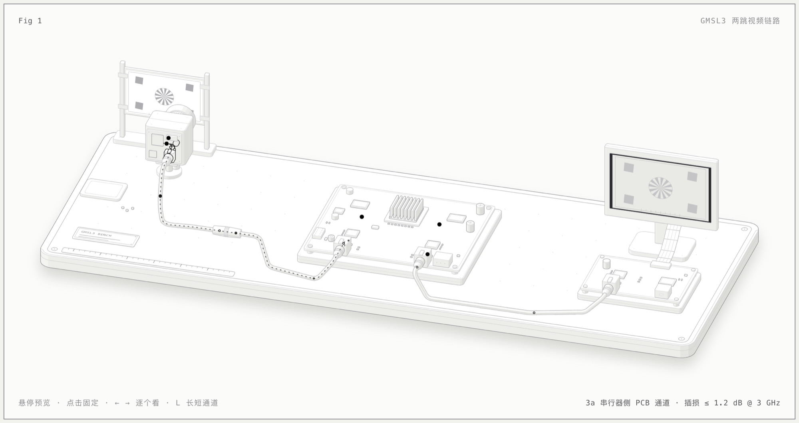

# GMSL3 两跳视频链路解剖图

一张可交互的等轴测示意图，把车载视频链路从头到尾摆在一张试验台上：

**车载摄像头 → 串行器 SER1 → 通道 A（PCB → 同轴线 → PCB）→ 解串器 DES1 → 控制器 → 串行器 SER2 → 通道 B（PCB → 同轴线 → PCB）→ 解串器 DES2 → 车载屏幕**

写给只熟悉其中一段的研发工程师：看完能说出每个模块干什么、每一段信号走什么接口、每一段在信号完整性上主要盯什么。

**在线打开：** <https://wangbrightly.github.io/gmsl3-link-anatomy/>（[深色版](https://wangbrightly.github.io/gmsl3-link-anatomy/dark.html)）



## 图里有什么

- 左边：摄像头对着一块测试卡，后盖拆下平放在旁边，露出串行器板（SER1、AC 耦合电容、PoC 电感、ESD、板载同轴插座）。
- 中间：同轴线经一节在线连接器接到去掉外壳的 ECU 主板，板上依次是 DES1、带散热片的控制器（两侧是内存）、SER2，以及把直流电注入通道 A 的 PoC 网络。
- 右边：第二根同轴线接到屏幕驱动板（DES2，PoC 位置空贴），排线把画面送进面板。屏幕上显示的就是摄像头对着的那张测试卡。

## 动画表达的是什么

| 画面 | 含义 |
|---|---|
| 实心亮点 | 前向 12 Gbps PAM4 视频。点的大小随 3 GHz 分量幅度变化：经过通道时按规格书插损上限变小，到解串器处恢复满格 |
| 小空心点 | 反向 187.5 Mbps NRZ 控制数据，从解串器往串行器走 |
| 虚线 | PoC 直流供电，ECU → 摄像头 |

最想让人一眼看懂的一点：**两跳是两段独立的 pin-to-pin 通道，插损预算不跨两跳累加**，因为 DES1 已经把信号还原了。

## 怎么用

- 鼠标悬停任一模块、走线或线缆：该部分高亮，下方说明区显示功能、输入输出接口、信号完整性关注点。
- 点击：固定当前选择，鼠标再移动也不变；点图中空白处或按 Esc 取消。
- 下方 15 个按钮对应 9 个节点 + 6 个通道子段（3a/3b/3c、7a/7b/7c），点 “通道 A / 通道 B” 会同时高亮三段。
- 键盘（整页有效）：`←` `→` 逐个看，`L` 切换长短通道，空格暂停动画，`Esc` 取消选择。
- “短通道 / 长通道” 切换会同时改动画里的衰减和下方的插损预算条。

## 数值来源

全部出自 Analog Devices《GMSL3 Channel Specification User Guide》Rev 4（2024-09），页面里每条都标了表号。主要几项：

| 项目 | 短通道 | 长通道 | 出处 |
|---|---|---|---|
| pin-to-pin 插损上限 @ 3 GHz | 10 dB | 18 dB | Table 2 |
| PCB 模块插损上限 @ 3 GHz | 1.2 dB | 1.2 dB | Table 9 |
| 线缆模块插损上限 @ 3 GHz | 7.6 dB | 15.6 dB | Table 9 |
| 最小链路裕量（前向 / 反向） | 100 / 50 mV | 100 / 50 mV | Table 8 |

1.2 + 7.6 + 1.2 = 10，1.2 + 15.6 + 1.2 = 18，模块预算正好凑满 pin-to-pin 上限。`model.mjs` 按规格书公式计算，动画和读数都只从这里取数。

注意：这些都是规格书给的**上限**，不是任何实测数据；回损不能逐段相加，规格书要求整段 pin-to-pin 一起评估。

## 图里的假设

- 各段视频接口（摄像头→SER1、DES1→控制器、控制器→SER2、DES2→屏幕）**没有指定**，页面上标 “待定”，只给常见做法举例。
- 通道 B 的组成与通道 A 相同（PCB / 同轴线 / PCB）。
- 屏幕按本地供电处理，PoC 只画在通道 A。
- 信号点的速度是示意，实际快约十亿倍。

## 自己重新生成

页面由 Node.js 脚本生成，依赖 [anatomy](https://github.com/wheresryan22/anatomy) 插图工具包：

```bash
git clone https://github.com/wheresryan22/anatomy ~/anatomy
ANATOMY=~/anatomy node build.mjs          # 生成 index.html（浅色）
ANATOMY=~/anatomy node build.mjs --dark   # 生成 dark.html（深色）
ANATOMY=~/anatomy node build.mjs --audit  # 几何检查：线缆不穿模、零件不悬空、遮挡顺序正确
```

| 文件 | 内容 |
|---|---|
| `build.mjs` | 试验台上所有零件的几何与页面组装 |
| `model.mjs` | 规格书公式（插损上限、预算、幅度换算） |
| `info.mjs` | 15 个对象的说明文字 |
| `live.js` | 动画、悬停、键盘交互 |
| `link.css` | 页面样式与深浅两套配色 |

生成的 HTML 是单个文件，不依赖网络，下载后双击即可打开。

## 赞赏

如果这张图帮你讲清楚了一件事，欢迎请作者喝杯咖啡 ☕

打开[在线页面](https://wangbrightly.github.io/gmsl3-link-anatomy/)，点右下角「☕ 赞赏」即可看到微信赞赏码。

## 许可与致谢

代码以 [MIT](LICENSE) 许可发布。页面内嵌了 [anatomy](https://github.com/wheresryan22/anatomy)（Copyright (c) 2026 Ryan，MIT 许可）的绘图工具代码。

GMSL 是 Analog Devices, Inc. 的商标。本项目与 Analog Devices 无关，规格数值仅供学习参考，设计请以官方最新文档为准。
